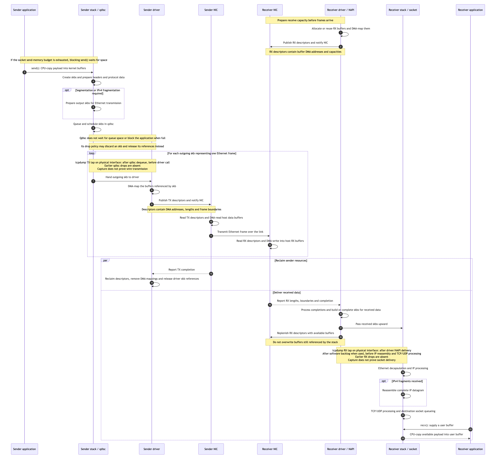

This describes ordinary socket I/O over Ethernet. The physical view follows the bytes; the software view follows the objects that describe and schedule them.

* toc
{:toc}

## Physical movement of payload bytes

- **Send:** An ordinary copying `send()` copies application payload from user memory into kernel data buffers. [Linux documentation: ordinary socket sending copies user buffers](https://docs.kernel.org/networking/msg_zerocopy.html)
- **DMA mapping:** On TX, the driver DMA-maps the buffers referenced by an outgoing skb and posts their DMA addresses, lengths, and instructions in TX-ring descriptors; the NIC reads those buffers. On RX, the driver DMA-maps available receive buffers and posts their addresses and capacities in RX-ring descriptors; the NIC writes incoming data into them and reports completion. The driver then builds an skb referencing the received data, or attaches it to a previously allocated skb, and passes it upward. Mapping normally does not copy the payload. [Linux DMA mapping guide](https://docs.kernel.org/core-api/dma-api-howto.html), [Bootlin skb allocation, slide 117](https://bootlin.com/doc/training/networking/networking-slides.pdf#page=117), [RX driver example](https://github.com/torvalds/linux/blob/master/drivers/net/ethernet/intel/e1000e/netdev.c)
- **Transmission:** The driver submits buffer addresses and instructions through TX descriptors. The NIC reads the buffers by DMA and transmits Ethernet frames. After completion, the driver can reclaim the associated resources. [Linux DMA guide](https://docs.kernel.org/core-api/dma-api-howto.html), [driver transmit guidelines](https://docs.kernel.org/networking/driver.html)
- **Receive:** The driver allocates or reuses receive buffers, DMA-maps them, and posts their DMA addresses and capacities in RX-ring descriptors. The NIC uses those descriptors to DMA-write incoming frame data and reports completion with received lengths and status. The driver builds skbs referencing the received data; the stack processes it and queues it at the destination socket. An ordinary `recv()` then copies payload into the receiving process's user buffer. [Linux DMA guide](https://docs.kernel.org/core-api/dma-api-howto.html), [RX driver example](https://github.com/torvalds/linux/blob/master/drivers/net/ethernet/intel/e1000e/netdev.c), [recv(2)](https://man7.org/linux/man-pages/man2/recv.2.html)

```text
SENDER HOST
Application's user buffer
    | CPU copies payload during ordinary send()
    v
Kernel data buffers, referenced by skb(s)
    | Driver DMA-maps these existing buffers;
    | TX descriptors hold their DMA addresses
    v
Sending NIC reads those buffers using DMA
    |
    v
================ Ethernet link ================
    |
    v
Receiving NIC writes frame data using DMA
    | RX descriptors point to available kernel buffers
    v
Kernel receive buffers, prepared and DMA-mapped by driver
    | Driver builds skb(s); protocol processing identifies the socket
    | Existing buffers can remain referenced rather than be copied again
    v
Socket receive queue holds references to received data
    | CPU copies payload during ordinary recv()
    v
Application's user buffer
```

- **The buffers are real memory:** Both sender and receiver use kernel data buffers for NIC DMA. DMA mapping makes those buffers accessible to the device; descriptors contain their addresses, not the payload bytes. [Linux DMA mapping guide](https://docs.kernel.org/core-api/dma-api-howto.html)
- **The socket options are limits:** `SO_SNDBUF` and `SO_RCVBUF` set per-socket send/receive memory-accounting limits. They are not separate contiguous memory regions and do not preallocate the NIC's TX/RX buffers or rings. Accounting includes overhead as well as payload. [Linux socket buffer options](https://man7.org/linux/man-pages/man7/socket.7.html)
- **Allocation differs by direction:** Outgoing socket data is prepared before the driver maps it for TX. RX buffers must already be available to the NIC before protocol processing knows the destination socket; `SO_RCVBUF` governs memory charged to that socket's receive path, not the entire driver RX-buffer pool. An additional payload copy between an RX buffer and a socket queue is not inherently required. [Linux DMA guide](https://docs.kernel.org/core-api/dma-api-howto.html), [Linux skb buffer references](https://docs.kernel.org/networking/skbuff.html), [socket buffer limits](https://man7.org/linux/man-pages/man7/socket.7.html)

## Logical processing and ownership

### skb and protocol units

- **What an skb describes:** `struct sk_buff` contains metadata and references to data buffers; payload bytes are stored outside the structure. Its data may occupy one buffer or several pages. Passing or queuing an skb does not inherently copy its payload. [Linux skb layout](https://docs.kernel.org/networking/skbuff.html)
- **At the Ethernet driver:** Without segmentation offload, one transmitted skb normally describes one Ethernet frame's data; the NIC supplies details such as FCS. The frame carries a complete IP datagram or one IPv4 fragment. Elsewhere in the stack, the skb's data view changes as headers are added or removed. [Linux netdevice contract](https://docs.kernel.org/networking/netdevices.html#mtu), [Bootlin, slides 106–111](https://bootlin.com/doc/training/networking/networking-slides.pdf#page=106)
- **Sender lifecycle:** The protocol stack creates skbs while preparing socket data; headers and buffer references evolve as they move through the stack and qdisc. The driver DMA-maps their buffers and posts TX descriptors. After the NIC finishes using those buffers, the driver removes the mappings and releases its skb references. TCP may retain other references for retransmission until acknowledgment. [Linux driver completion rules](https://docs.kernel.org/networking/driver.html), [DMA mapping lifetime](https://docs.kernel.org/core-api/dma-api-howto.html), [shared skb data](https://docs.kernel.org/networking/skbuff.html#shared-skbs-and-skb-clones)
- **Receiver lifecycle:** The NIC fills driver-supplied RX buffers. The driver creates or completes skbs referencing that data and passes them upward for protocol processing and socket delivery; skb metadata may have been allocated before reception or built afterward. As data is consumed or discarded, references are released. The driver must replenish RX capacity without overwriting buffers still referenced by the stack. [Linux skb allocation and buffers](https://docs.kernel.org/networking/skbuff.html), [RX driver example](https://github.com/torvalds/linux/blob/master/drivers/net/ethernet/intel/e1000e/netdev.c)
- **Relationship to descriptors:** An skb describes data to kernel software; TX/RX descriptors give the NIC DMA addresses and lengths for the underlying buffers. The driver maintains the association. One skb's data may span several descriptors. Reclaiming a descriptor slot does not by itself free every reference to the data: shared buffers remain alive until their last reference is released. [Linux driver guidelines](https://docs.kernel.org/networking/driver.html), [Linux skb reference counting](https://docs.kernel.org/networking/skbuff.html#shared-skbs-and-skb-clones)

### Offload changes where work happens

- **GSO/TSO:** One large skb can represent data for several future TCP segments. Software GSO splits it before the driver; TSO delegates segmentation to the NIC. Each resulting segment has its own IP/Ethernet headers: these are complete IP datagrams, not IPv4 fragments. [Bootlin, slide 129](https://bootlin.com/doc/training/networking/networking-slides.pdf#page=129), [Linux segmentation offloads](https://docs.kernel.org/networking/segmentation-offloads.html)
- **IP fragmentation:** Normally performed in the kernel IP layer. UFO can delegate UDP/IPv4 fragmentation to the NIC, but it is deprecated and modern kernels no longer normally generate UFO skbs. The skb describes the data and required processing in either case. [Bootlin, slide 103](https://bootlin.com/doc/training/networking/networking-slides.pdf#page=103), [Linux UFO documentation](https://docs.kernel.org/networking/segmentation-offloads.html#udp-fragmentation-offload)
- **Receive-side GRO:** GSO, TSO, and UFO describe transmit operations. On reception, Generic Receive Offload (GRO) combines compatible received data into larger skbs to reduce stack processing overhead. Some NICs provide hardware GRO or LRO aggregation. Consequently, one receive skb can represent data from several Ethernet frames. [Linux GRO documentation](https://docs.kernel.org/networking/segmentation-offloads.html#generic-receive-offload), [Linux hardware receive features](https://docs.kernel.org/networking/netdev-features.html)
- **Receive-side IPv4 reassembly:** This runs in the IP layer, above the Ethernet driver and Ethernet-header processing. Received Ethernet-frame data reaches the stack through skbs; Ethernet processing identifies IPv4 and advances the data view past the Ethernet header. The IP layer then uses IPv4 fragment identifiers and offsets to reconstruct one complete IP datagram before transport-layer delivery. It operates on IP fragments represented by skbs, not on Ethernet frames. GRO serves a different purpose: aggregating compatible received data for efficiency. [Bootlin Ethernet decapsulation, slide 119](https://bootlin.com/doc/training/networking/networking-slides.pdf#page=119), [IPv4 reassembly specification](https://www.rfc-editor.org/rfc/rfc791.html), [Linux GRO documentation](https://docs.kernel.org/networking/segmentation-offloads.html#generic-receive-offload)
- **Who operates on skbs:** Kernel GSO, fragmentation, GRO, and reassembly operate on skb metadata and referenced data, creating, splitting, or combining representations as needed. For hardware offload, the driver translates skb metadata into NIC instructions or interprets completion metadata; the NIC accesses descriptors and buffers rather than Linux skb structures. [Linux segmentation offloads](https://docs.kernel.org/networking/segmentation-offloads.html), [Linux skb layout](https://docs.kernel.org/networking/skbuff.html), [NIC driver example](https://github.com/torvalds/linux/blob/master/drivers/net/ethernet/intel/e1000e/netdev.c)

### TX/RX rings connect the driver to the NIC

- **What a ring contains:** A circular array of descriptors, typically in host RAM, directly used by the NIC. Each entry contains DMA addresses, lengths/capacities, and instructions/status. The NIC reads descriptors, not skb structures. [Linux DMA guide](https://docs.kernel.org/core-api/dma-api-howto.html), [Intel driver example](https://github.com/torvalds/linux/blob/master/drivers/net/ethernet/intel/e1000e/netdev.c)
- **TX ownership cycle:** The driver maps skb data buffers, fills descriptors, and notifies the NIC. The NIC reads the descriptors and data and reports completion. The driver then releases the associated buffer references and reuses ring slots. The skb must remain valid for as long as the driver needs it. [Linux driver transmit guidelines](https://docs.kernel.org/networking/driver.html)
- **RX ownership cycle:** Driver posts available buffers -> NIC fills them and reports completion -> driver passes the data upward using skbs and replenishes buffers. Memory still used by the stack must not be overwritten. [Linux DMA guide](https://docs.kernel.org/core-api/dma-api-howto.html), [Intel driver example](https://github.com/torvalds/linux/blob/master/drivers/net/ethernet/intel/e1000e/netdev.c)
- **Several slots per frame:** A frame's data may span several buffers/descriptors. Typical TX rings use successive entries ending in a frame-end marker; RX completion metadata identifies received frame boundaries. This is memory scatter-gather, not IP fragmentation; details depend on the NIC. [Linux skb layout](https://docs.kernel.org/networking/skbuff.html), [Intel driver example](https://github.com/torvalds/linux/blob/master/drivers/net/ethernet/intel/e1000e/netdev.c)

## Sequence from sending application to receiving application

This shows the ordinary copying path without segmentation or receive-aggregation offload. The frame-transfer steps repeat as needed; one application send need not produce only one frame. Ring descriptors and data buffers are in host RAM. Arrows labelled notification/completion describe coordination, while DMA and CPU-copy labels describe byte movement. [Linux DMA guide](https://docs.kernel.org/core-api/dma-api-howto.html), [Linux netdevice contract](https://docs.kernel.org/networking/netdevices.html#mtu), [Bootlin transmit path, slide 225](https://bootlin.com/doc/training/networking/networking-slides.pdf#page=225)



TX completion permits driver cleanup; it does not confirm delivery to the receiving application. The NIC accesses DMA buffers and hardware descriptors, while the kernel manages skbs and their references. [Linux driver completion rules](https://docs.kernel.org/networking/driver.html), [Linux skb reference counting](https://docs.kernel.org/networking/skbuff.html#shared-skbs-and-skb-clones), [recv(2)](https://man7.org/linux/man-pages/man2/recv.2.html) The socket-memory wait and qdisc-drop notes follow [send(2)](https://man7.org/linux/man-pages/man2/send.2.html). The tcpdump notes describe ordinary Linux physical-interface packet taps: `dev_queue_xmit_nit()` in `xmit_one()` on TX and packet-type taps in `__netif_receive_skb_core()` on RX. [Linux TX/RX capture hooks](https://github.com/torvalds/linux/blob/v6.6/net/core/dev.c).

## Where data can be lost and what to inspect

Take timestamped snapshots before and after the same test window, and compare **counter increases**. Select the actual data interfaces and network namespaces. Interface, per-CPU, network-namespace and per-socket counters have different scopes; a host-wide increase does not identify one application flow. [Linux statistics](https://docs.kernel.org/networking/statistics.html), [ss socket statistics](https://man7.org/linux/man-pages/man8/ss.8.html)

| Location / possible cause | Statistics or evidence to inspect | What the evidence establishes |
|---|---|---|
| **Sender socket: allocation or send failure** | Application `send()` return values and errors; `ss -m` send-memory usage; `UdpSndbufErrors` for applicable UDP buffer errors. | Identify failure before successful submission. A successful send does not guarantee remote delivery. A full TCP send buffer normally blocks or returns `EAGAIN` in nonblocking mode. [send(2)](https://man7.org/linux/man-pages/man2/send.2.html), [UDP implementation](https://github.com/torvalds/linux/blob/master/net/ipv4/udp.c) |
| **Sender IP output: route, memory or fragmentation failure** | `IpOutNoRoutes`, `IpOutDiscards`, `IpFragFails`; application `EMSGSIZE` errors. | Identify IP-output failures; inspect route/MTU and send errors to distinguish causes. [Kernel IP counters](https://docs.kernel.org/networking/snmp_counter.html), [IPv4 output implementation](https://github.com/torvalds/linux/blob/master/net/ipv4/ip_output.c) |
| **Sender qdisc: queue limit or drop policy** | `tc -s qdisc show dev IFACE`: `dropped`, backlog and requeues. | `dropped` identifies qdisc loss; backlog/requeues alone do not. Qdisc admission does not wait for space or directly block the application: it schedules an interface shared by many sockets and forwarded flows, and can run in contexts where no originating application thread can be suspended. Socket-memory blocking is separate. This makes qdisc a common local drop point during bursts that exceed its drain rate and queue capacity, even at low average bandwidth. A drop can also be policy-driven before the queue fills. Root `mq` and child totals may overlap. [send(2): blocking and device-queue overflow](https://man7.org/linux/man-pages/man2/send.2.html), [qdisc implementation](https://github.com/torvalds/linux/blob/master/net/sched/sch_generic.c), [pfifo_fast](https://man7.org/linux/man-pages/man8/tc-pfifo_fast.8.html) |
| **Sender driver/NIC: resource or transmission error** | `tx_errors`, `tx_dropped`, `tx_fifo_errors`; driver-specific DMA errors, timeouts and reset counters in `ethtool -S`. | DMA mapping failure can discard an skb; FIFO underrun or device errors can abort a transmission. Counter coverage is driver-dependent. [DMA failures](https://docs.kernel.org/core-api/dma-api-howto.html), [TX statistics](https://docs.kernel.org/networking/statistics.html) |
| **TX descriptor exhaustion** | Driver queue stop/wake counts, completion progress and qdisc backlog/drops. | Usually indicates backpressure: the driver stops the TX queue until descriptors are reclaimed. Stop/wake events are not dropped-frame counts. [Driver queue rules](https://docs.kernel.org/networking/driver.html) |
| **Link or switch loss** | Switch-port discard/error counters; matched sender-egress and receiver-ingress captures. | No universal host counter confirms switch loss. Sender-captured/receiver-absent data narrows the interval, but driver/NIC loss and capture loss must also be checked. [Linux interface-statistics scope](https://docs.kernel.org/networking/statistics.html) |
| **Receiver NIC: invalid Ethernet frame** | `rx_crc_errors`, `rx_length_errors`, `rx_frame_errors`, aggregate `rx_errors`, and driver/PHY counters. | Confirms reported frame errors; a CRC increase does not identify the faulty cable, port or transmitter by itself. [RX statistics](https://docs.kernel.org/networking/statistics.html) |
| **Receiver RX ring/buffers exhausted** | `rx_missed_errors`, `rx_over_errors`; driver-specific RX no-buffer/no-descriptor/per-queue drops and buffer-allocation failures. | Indicates unavailable receive capacity or related overruns as defined by the driver. `rx_dropped` alone is not a complete RX-ring-loss measurement. [RX statistics](https://docs.kernel.org/networking/statistics.html) |
| **Receiver CPU software backlog overflows:** The NIC DMA-writes received bytes into buffers, and the driver prepares skbs describing that data. When this backlog path is used, the skbs wait in a per-CPU software queue for higher-layer processing (IP, TCP/UDP and socket delivery). The NIC does not construct Linux skbs, and not every receive path uses this queue. | `/proc/net/softnet_stat`: second column (`dropped`) for each CPU, in hexadecimal. Test-window drops = sum of all CPU counters at the end minus their sum at the start, assuming no reboot or counter reset. Retain each CPU’s increase as well. Compare per-CPU load, IRQ/softirq activity, traffic rates and `net.core.netdev_max_backlog`. | Confirms software receive-backlog drops, separate from RX-ring loss. A busy CPU, uneven traffic distribution or short bursts can make incoming work exceed processing capacity; low whole-host average CPU usage does not rule this out. The total establishes backlog loss, not CPU overload by itself or loss of a particular application’s traffic. Per-CPU increases help identify concentrated pressure. The third field (`time_squeeze`) indicates processing-budget pressure, not a drop count. [Receive scaling](https://docs.kernel.org/networking/scaling.html), [Kernel softnet statistics](https://github.com/torvalds/linux/blob/master/net/core/net-procfs.c) |
| **Receiver IP input validation/resources** | `IpInHdrErrors`, `IpInAddrErrors`, `IpInDiscards`. | Distinguish invalid IP headers/addresses from internal receive-path discards; these are separate from Ethernet CRC errors. Use drop-reason tracing when a broad discard counter is insufficient. [Kernel IP counters](https://docs.kernel.org/networking/snmp_counter.html) |
| **Receiver IPv4 reassembly fails** | `IpReasmFails`, `IpReasmTimeout`, `IpReasmReqds`, `IpReasmOKs`; `/proc/net/sockstat` `FRAG memory`; `ipfrag_high_thresh` and `ipfrag_time`. | Confirms reassembly failures. Correlate occupancy, limits, timeouts and missing fragments in captures to distinguish memory pressure from incomplete arrivals. Timeout accounting is delayed; failures need not coincide with the original loss. [Reassembly implementation](https://github.com/torvalds/linux/blob/master/net/ipv4/ip_fragment.c), [IP settings](https://docs.kernel.org/networking/ip-sysctl.html) |
| **Receiver UDP socket cannot accept a datagram** | `UdpRcvbufErrors`; target socket memory/drop count from `ss -u -m`; also `UdpInCsumErrors`, `UdpNoPorts`, and aggregate `UdpInErrors`. | Receive-buffer errors point to socket queue/memory admission; checksum errors and no-listener errors are distinct causes. `UdpInErrors` overlaps detailed error counts, so do not sum them. [UDP receive implementation](https://github.com/torvalds/linux/blob/master/net/ipv4/udp.c), [ss memory/drop fields](https://man7.org/linux/man-pages/man8/ss.8.html) |
| **TCP receiver stalls / TCP recovers loss** | `ss -tinm` queues/memory/retransmissions; capture advertised windows; `TcpRetransSegs` and relevant TCP timeout counters. | A zero receive window is flow-control backpressure, not proof of NIC loss. Retransmissions indicate recovery attempts, not the exact loss location or permanent application-data loss. [TCP flow control](https://www.rfc-editor.org/rfc/rfc9293.html#section-3.8.6.1), [Kernel TCP counters](https://docs.kernel.org/networking/snmp_counter.html) |
| **Policy or application discards** | Firewall/TC/XDP rule-specific counters where available; DDS/application sample IDs and callback counts. | Filters or middleware can discard data even when NIC counters are clean. There is no universal kernel counter for a missing DDS sample. For unresolved kernel drops, trace skb drop reasons/call sites where supported. [Bootlin skb drops, slide 118](https://bootlin.com/doc/training/networking/networking-slides.pdf#page=118) |

## tcpdump and the data unit in a pcap

- **What is captured:** On the ordinary Linux packet-socket path, tcpdump uses libpcap to capture packet bytes represented by skbs at the capture hook. It does not save the `struct sk_buff`, its pointers or all its metadata. An skb is a kernel representation, not a new protocol data unit. [Linux packet sockets](https://man7.org/linux/man-pages/man7/packet.7.html), [Linux skb layout](https://docs.kernel.org/networking/skbuff.html)
- **One pcap record:** A captured-packet record contains a timestamp, captured length, original reported packet length and captured bytes. Snapshot length can truncate those bytes. Interpret them using the capture's link-layer type: a physical Ethernet capture normally includes an Ethernet header, while Linux `any` normally uses a cooked capture header. A record is not inherently one application message or one complete IP datagram. [libpcap capture format and link-layer types](https://man7.org/linux/man-pages/man3/pcap.3pcap.html)
- **Without segmentation/aggregation offload:** On an ordinary Ethernet interface, one record normally represents one Ethernet frame's captured bytes, usually without FCS. For IP traffic, that frame can contain a complete IP datagram or one IP fragment. A fragmented UDP datagram therefore spans multiple records; noninitial IPv4 fragments do not contain the UDP header. Reassembly by an analysis tool does not change the original record boundaries. [libpcap](https://man7.org/linux/man-pages/man3/pcap.3pcap.html), [IPv4 fragmentation](https://www.rfc-editor.org/rfc/rfc791.html)
- **TCP with offload:** A TX capture can observe a large skb before TSO splits it into several wire TCP segments; an RX capture can observe GRO-aggregated data. Software GSO may already have split the skb before the TX tap. Consequently, one record need not equal one wire segment or frame, and TCP record boundaries do not preserve application `send()` boundaries. [Linux segmentation offloads](https://docs.kernel.org/networking/segmentation-offloads.html), [Linux TX capture path](https://github.com/torvalds/linux/blob/v6.6/net/core/dev.c)
- **UDP with offload:** Where UDP segmentation or aggregation is used, one captured representation may cover multiple UDP datagrams. This differs from IPv4 fragmentation of one UDP datagram. Do not assume either “one skb = one UDP datagram” or “one pcap record = one UDP datagram” throughout the path. [Linux UDP segmentation and aggregation](https://docs.kernel.org/networking/segmentation-offloads.html)
- **Comparing captures:** Compare the appropriate protocol identity and byte ranges, not just record counts. For TCP, account for sequence ranges, retransmissions and different segmentation boundaries. For IPv4 fragments, account for source/destination, protocol, identification, fragment offset, length and identification reuse over time. Record capture drops, filters, snapshot length and offload settings before interpreting unmatched records as loss. [TCP sequence space](https://www.rfc-editor.org/rfc/rfc9293.html), [IPv4 fragment identification](https://www.rfc-editor.org/rfc/rfc791.html), [libpcap](https://man7.org/linux/man-pages/man3/pcap.3pcap.html)
